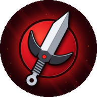
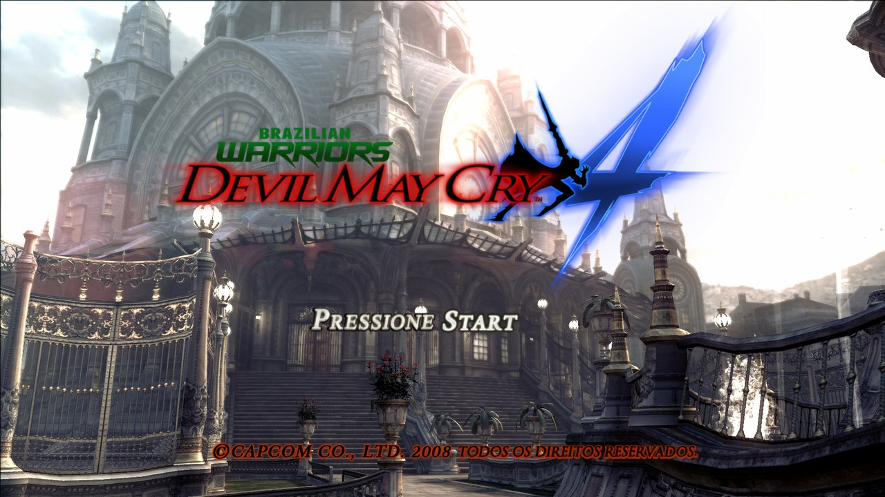
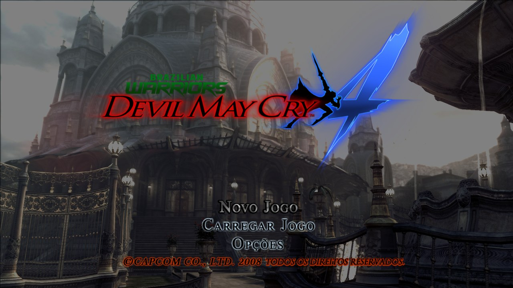
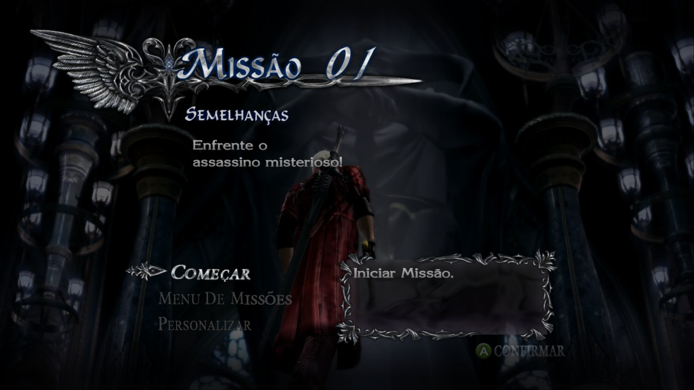
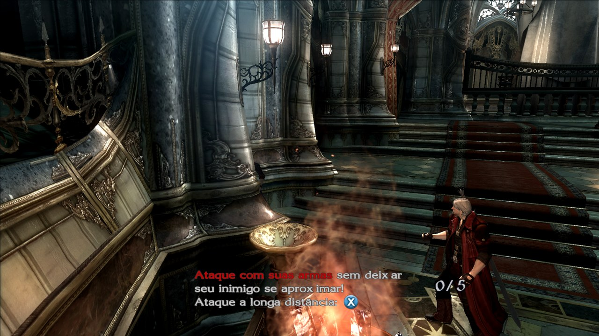

<div align="center">



# 😈 Devil May Cry 4 — Port Nativo

**O jogo de Xbox 360 rodando nativamente no Android (ARM64), sem emulador de CPU e com renderizador nativo.**


[Sobre](#-sobre) · [Recursos](#-o-que-o-port-oferece) · [Requisitos](#-requisitos) · [Versão do jogo](#-versão-do-jogo-obrigatória) · [Configurações](#%EF%B8%8F-configurações) · [Controles](#-controles) · [Perguntas](#-perguntas-frequentes)



</div>

---

## 📖 Sobre

Este port **não é um emulador de Xbox 360**. O executável do jogo (`default.xex`) é **recompilado estaticamente** de PowerPC para ARM64: o resultado é código nativo, que roda direto no processador do celular.

A parte gráfica usa o **shadowZero**, um renderizador nativo que pega os comandos Direct3D do jogo e desenha direto em Vulkan, sem emular a GPU do Xbox 360. Isso deixa o jogo bem mais leve e permite escolher a resolução interna de **360p até 4K**.

> [!IMPORTANT]
> **Nada do jogo é distribuído aqui.** Você precisa da sua **própria cópia** de *Devil May Cry 4* para Xbox 360, na versão indicada em [Versão do jogo](#-versão-do-jogo-obrigatória).

> [!NOTE]
> **Versão em testes.** O jogo roda da tela de título às missões, com textos em português, mas ainda está sendo ajustado. O APK ainda não foi publicado: ele vai aparecer na página de [**Releases**](../../releases).

## ✨ O que o port oferece

- Recompilação estática do jogo para **ARM64**, sem interpretador de CPU.
- Renderizador nativo **shadowZero** (Direct3D → Vulkan), com resolução interna de **360p, 480p, 720p, 1080p, 2K e 4K**. Em 2K e 4K as sombras ficam na qualidade do 1080p para pesar menos.
- **60 FPS**, como no console, ou **45 / 30 FPS** para aliviar a GPU sem deixar o jogo lento (a lógica continua a 60).
- **Modo desempenho (Devil Trigger):** tira as sombras, deixa as texturas mais leves e simplifica efeitos de tela, na resolução que você escolher.
- **Controles na tela** com ícones de cada ação (Espada, Pistola, Devil Bringer, Exceder, Devil Trigger...), com editor para mover, redimensionar, esconder e ajustar a transparência.
- **Controles físicos** Bluetooth e USB (Xbox 360, PS3 e outros), com tela para **mapear** os botões.
- **Importar save** feito em outro lugar e **pular o vídeo de abertura** (evita a tela preta em aparelhos fracos).
- **Drivers de GPU customizados (Turnip)** em celulares **Snapdragon**, importados direto pelo menu.
- Menu no tema do jogo, painel de desempenho (FPS, CPU e RAM) e botão de enviar log.

## 📸 Capturas

| Tela de título | Menu principal |
|:---:|:---:|
|  |  |
| **Missão 01** | **Luta** |
|  |  |

<sub>Capturas em 1080p, feitas com o mesmo renderizador shadowZero do APK.</sub>

## 📱 Requisitos

| | Mínimo | Recomendado |
|---|---|---|
| **Android** | 11 (API 30) | 13 ou mais novo |
| **Processador** | ARM64 (arm64-v8a) | Snapdragon 7 Gen 1 / Dimensity 8000 ou superior |
| **GPU** | Vulkan 1.1 | Mali-G710 / Adreno 730 ou superior |
| **RAM** | 4 GB | 8 GB ou mais |
| **Espaço** | os arquivos do jogo (cerca de 6,5 GB) | — |

### Aparelhos testados

| Aparelho | Chip / GPU | Resultado |
|---|---|---|
| POCO X7 Pro | Dimensity 8400 / Mali-G720 | 60 FPS em 1080p na missão 1; 4K com modo desempenho na casa dos 45 FPS |
| Redmi 15 | Snapdragon 680 / Adreno 610 | imagem certa desde a 0.3.3; aparelho de entrada, use 360p ou 480p |

## 💿 Versão do jogo (obrigatória)

O port é feito para **uma versão específica** do executável. O código é recompilado a partir deste arquivo, então o que vale é o `default.xex` ser **idêntico**: confira o hash abaixo.

| Campo | Valor |
|---|---|
| Jogo | Devil May Cry 4 (Xbox 360) |
| Title ID | `434307DF` |
| Media ID | `6729D527` |
| Versão do executável | `0.0.0.3` |
| Idioma | versão com textos em português do Brasil (tradução Brazilian Warriors) |

| Arquivo | Tamanho | SHA-1 | MD5 |
|---|---|---|---|
| `default.xex` | 3.915.776 bytes | `df7d351a897450ba6d40bc5f46f0ce05c05fe54c` | `6e3d132ff521f2a1a59645b34e5f0936` |

<details>
<summary><b>Como conferir o hash</b></summary>

- **Windows (PowerShell):** `Get-FileHash default.xex -Algorithm SHA1`
- **Linux / macOS:** `sha1sum default.xex`
- **Android:** qualquer app de "hash checker" da Play Store.

</details>

A pasta do jogo fica assim:

```
Pasta do jogo/
├── default.xex
└── nativeXenon/
    ├── language/
    ├── movie/
    ├── rom/
    ├── rom_xbox/
    ├── sound/
    └── system/
```

## 🚀 Instalação

1. Baixe o **APK** na página de [**Releases**](../../releases) (quando sair) e instale. Talvez seja preciso permitir *"instalar apps de fontes desconhecidas"*.
2. Copie a pasta do jogo para o celular, por exemplo `Armazenamento interno/DMC4`.
3. Abra o app e toque em **ESCOLHER PASTA**.
4. Permita o **acesso a todos os arquivos**: o jogo lê os dados direto da pasta, sem copiar nada.
5. Escolha a pasta que contém o `default.xex` e a `nativeXenon`.
6. Ajuste as configurações e toque em **JOGAR**.

> [!TIP]
> Na primeira vez que cada cena aparece, o jogo prepara os shaders e pode engasgar um pouco. Nas próximas vezes eles já ficam salvos.

## ⚙️ Configurações

| Opção | O que faz | Impacto no desempenho |
|---|---|---|
| **Resolução 360p / 480p** | Desenha o jogo com menos pixels | 🟢 Mais FPS: ideal para celulares mais fracos |
| **Resolução 720p** | Resolução original do Xbox 360 | ⚪ Padrão |
| **Resolução 1080p** | 2,25 vezes os pixels do 720p | 🟠 Mais pesado |
| **Resolução 2K / 4K** | Imagem bem mais lisa; sombras na qualidade do 1080p | 🔴 Muito pesado: só para celular topo de linha |
| **Modo desempenho** | Sem sombras, texturas mais leves e efeitos de tela mais simples | 🟢 Mais leve, principalmente em 2K e 4K |
| **Taxa de quadros 60 / 45 / 30** | Quantos quadros por segundo são desenhados; o jogo continua na velocidade normal | 🟢 45 e 30 aliviam a GPU |
| **Tela: 16:9 / Esticar** | Mantém a proporção original ou estica para a tela toda | ⚪ Nenhum |
| **Painel de FPS** | Mostra FPS, CPU e RAM durante o jogo | ⚪ Quase nenhum |
| **Pular vídeo de abertura** | Vai direto à tela de título | ⚪ Nenhum |
| **Driver da GPU** (só Snapdragon) | Usa o driver do sistema ou um driver **Turnip** importado (`.zip` no formato AdrenoTools) | Depende do aparelho e do driver |

> [!NOTE]
> Se o FPS cair, ligue o **modo desempenho**, escolha **45** ou **30 FPS** e baixe a resolução. Para **4K a 45 FPS** em celular topo de linha, use **4K + modo desempenho + 45 FPS**. Ponha o jogo no Game Turbo / Game Space do celular e evite jogar carregando.

## 🎮 Controles

| Botão na tela | Controle | Ação no jogo |
|---|---|---|
| Espada | Y | ataque corpo a corpo |
| Pistola | X | tiro |
| Pulo | A | pulo |
| Devil Bringer | B | agarrar / puxar inimigos (Nero) |
| Exceder | LT | carregar a Red Queen (Nero) |
| Mira | RB | travar no inimigo |
| Devil Trigger | LB | Devil Trigger |
| Direcional | D-pad | estilo / arma (Dante) |
| Provocar / Pausa | Back / Start | provocação e menu de pausa |

- **Controles na tela:** toque na engrenagem **⚙** no topo para mover, redimensionar ou esconder cada botão e ajustar a transparência.
- **Controle físico:** controles Bluetooth e USB compatíveis com Android são reconhecidos automaticamente; o mapeamento pode ser mudado no menu, em **Controles → MAPEAR**.

## ❓ Perguntas frequentes

<details>
<summary><b>Onde baixo?</b></summary>

O APK ainda não foi publicado. Quando sair, ele vai estar na página de **[Releases](../../releases)**, com as notas de cada versão.

</details>

<details>
<summary><b>O jogo fecha ao abrir / tela preta</b></summary>

- Confira se o `default.xex` bate com o hash acima.
- Confira se a permissão de **acesso a todos os arquivos** foi dada.
- Confira se a pasta escolhida é a que contém o `default.xex` e a `nativeXenon`, e não uma pasta acima dela.
- Ligue **Pular vídeo de abertura**: em aparelhos fracos o vídeo pode demorar muito e ficar preto.
- Se você trocou o **Driver da GPU**, volte para **Sistema**.

</details>

<details>
<summary><b>Funciona com outra versão ou região do disco?</b></summary>

Só se o `default.xex` for **idêntico** (mesmo SHA-1 da tabela). Com hash diferente, não funciona.

</details>

<details>
<summary><b>Tem dublagem em português?</b></summary>

Não. A versão suportada traz os textos e menus em português; as vozes são as originais em inglês.

</details>

<details>
<summary><b>O código-fonte está disponível?</b></summary>

Este repositório traz só a documentação. Os componentes de código aberto usados (incluindo os de licença GPL-3.0 do renderizador nativo) estão listados abaixo, com as respectivas licenças.

</details>

## 🙏 Créditos

Este projeto só foi possível graças a estes projetos de código aberto:

- [**XenonRecomp**](https://github.com/hedge-dev/XenonRecomp): recompilador estático de PowerPC (Xbox 360)
- [**reNut**](https://github.com/masterspike52/reNut) e os ports [masseffect-nx](https://github.com/nebadasSwifty/masseffect-nx), [nfsmw-nx](https://github.com/StevensND/nfsmw-nx), banjo-nx e sa2-nx: base do renderizador nativo shadowZero
- [**plume**](https://github.com/renderbag/plume) e [**XenosRecomp**](https://github.com/hedge-dev/XenosRecomp): camada Vulkan e tradução dos shaders do Xbox 360
- [**Xenia Canary**](https://github.com/xenia-canary/xenia-canary): referência do hardware do Xbox 360
- [**SDL 3**](https://github.com/libsdl-org/SDL): janela, entrada e áudio
- [**FFmpeg**](https://ffmpeg.org): decodificação de áudio XMA
- [**libadrenotools**](https://github.com/bylaws/libadrenotools): drivers de GPU customizados no Android
- À equipe **Brazilian Warriors**, pela tradução do jogo para o português, que não tem relação com este port

As licenças completas estão em [THIRD_PARTY_NOTICES.md](THIRD_PARTY_NOTICES.md).

## ⚖️ Aviso legal

Este é um projeto de fãs, **sem fins lucrativos**, sem nenhuma ligação com a Capcom ou a Microsoft. *Devil May Cry* é marca e obra de seus respectivos donos.

O APK **não inclui** arquivos, vídeos, sons ou texturas do jogo: é preciso ter a sua própria cópia original. Não peça nem compartilhe arquivos do jogo nas issues.

---

<div align="center">
Feito com 🧡 por <a href="https://www.youtube.com/@Ll_Shadowll">SHADOWll</a>
</div>
